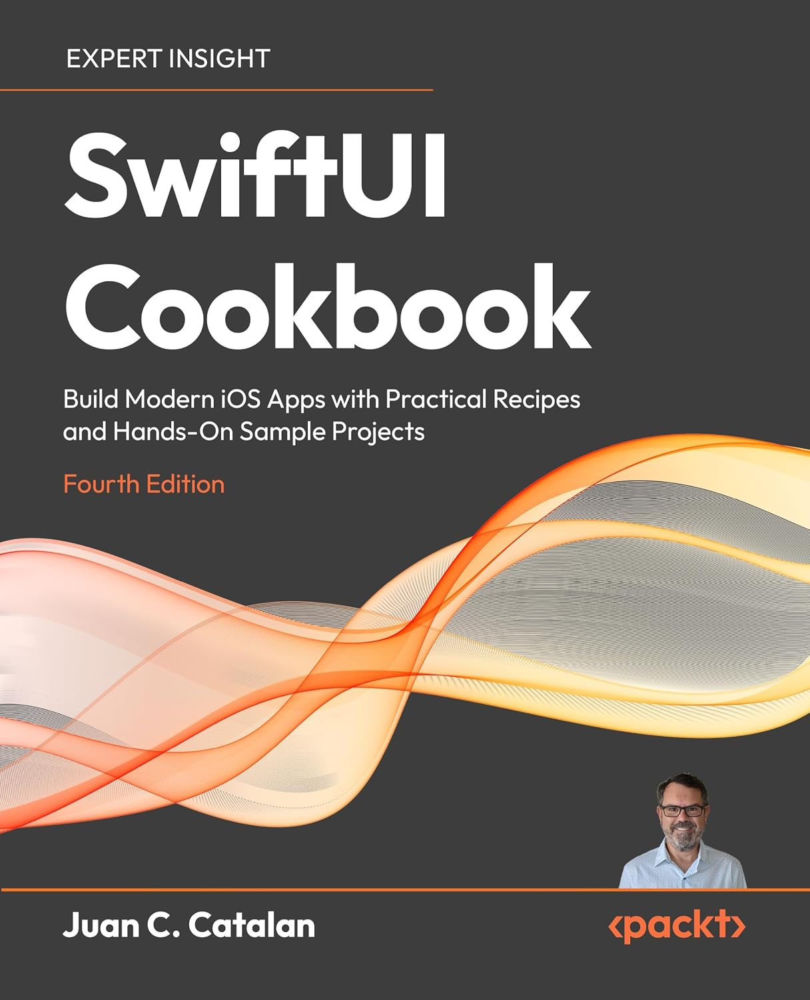

# SwiftUI Cookbook - Fourth Edition

This is the code repository for [SwiftUI Cookbook - Fourth Edition](https://x.swiftuicookbook.com/packt), published by Packt.

**Build Modern iOS Apps with Practical Recipes and Hands-On Sample Projects**

## What is this book about?

SwiftUI Cookbook, Fourth Edition is a practical guide to building modern iOS apps with SwiftUI. Fully updated for iOS 27, Xcode 27, and Swift 6.4, including Apple's new Liquid Glass design, this edition introduces a beginner-friendly structure while retaining the cookbook approach developers love. All of its text is new compared to the third edition. Of its 54 sample apps, only two were carried over from the third edition, and both have been updated for iOS 27.

The book is structured in three parts. Starting with the fundamentals of SwiftUI, you'll build lists with search, prototype with Xcode previews, and design interactive forms and reusable views. You'll then master data flow with the Observation framework, persist data with SwiftData, fetch remote content with async/await, and learn to debug, test, and profile your apps. The final part explores custom layouts, navigation and deep linking, animations, Canvas drawing, Liquid Glass visual effects, Swift Charts, WebView integration, and rich text, and closes with Apple Intelligence: generating text, structured data, and images with the Foundation Models framework and Image Playground.

You can use it as a traditional cookbook, jumping to any recipe that solves your immediate problem, or read it from start to finish to build your SwiftUI skills progressively. Every recipe is built around a focused, practical sample app and follows a consistent structure: Getting ready, How to do it, How it works, and See also.

This edition includes a companion Xcode project repository with step-by-step code files for every recipe. Each project contains individual Step files that match the numbered steps in the book, complete with `#Preview` blocks so you can follow along visually in the preview canvas without typing a single line of code.

## What you will learn
- Build apps for iOS 27 with the latest SwiftUI APIs and the new Liquid Glass design
- Prototype rapidly with Xcode previews and compose reusable views
- Build responsive layouts with stacks, grids, and custom layouts
- Manage app state with the Observation framework and bindings
- Persist data with SwiftData, AppStorage, and local files
- Integrate remote APIs with async/await, Codable, and Combine
- Debug, test, profile, and improve the accessibility of your apps
- Master navigation, modal sheets, and deep linking
- Create animations, Canvas drawings, and Liquid Glass effects
- Build interactive 2D and 3D charts with Swift Charts
- Integrate web content, PDF, Markdown, and rich text into your apps
- Generate text, structured data, and images with Apple Intelligence, using Foundation Models and Image Playground

## Who is this book for
This book is for iOS developers, Swift programmers, and Apple platform enthusiasts looking to build modern apps with SwiftUI. Beginners will benefit from the progressive structure and practical examples, while experienced developers can use the cookbook recipes to quickly implement advanced features using the latest iOS APIs. No prior SwiftUI experience is required; familiarity with Swift basics will help you get the most from the book. You'll also find this book to be a helpful reference whenever you need to implement a specific feature in SwiftUI or catch up with the changes Apple introduced in iOS 26 and iOS 27.

## Table of Contents

### Part I - Getting Started with SwiftUI
1. SwiftUI Essentials
2. Lists, Scroll Views, and Search
3. Prototyping and Previews
4. User Input and View Composition

### Part II - Data Flow in SwiftUI
5. State and Data Binding
6. App-Wide Settings and Accessibility
7. Data Persistence and Local Storage
8. Networking and Remote Data
9. Debugging, Testing, and Performance

### Part III - Advanced APIs
10. Grids and Layout
11. Navigation, Sheets, and Deep Linking
12. Drawing, Animations, and Visual Effects
13. Swift Charts
14. Web Content and Rich Text
15. On-Device Intelligence in SwiftUI

If you feel this book is for you, get your copy today on [Packt](https://x.swiftuicookbook.com/packt) or [Amazon](https://x.swiftuicookbook.com/amazon)!

## Instructions and Navigation
All the code is organized by chapter. Each `chNN/` directory contains one folder per recipe (`recipeNN/`), each holding an Xcode project. A few recipes start from a prepared project instead of an empty one; their folders hold a `Starter` project to code along with and a `Complete` project with the finished app. Inside each project you'll find a `Steps/` folder with individual Swift files matching the numbered steps in the book, so you can preview any intermediate state in the preview canvas. Each chapter folder contains an `assets/` subfolder with static files (images, JSON, etc.) for readers who want to create their own Xcode project and code along with the book. The recipe projects already include these assets. See [Instructions.md](Instructions.md) for detailed setup and usage guide.

### Software List

| Chapter | Software required | OS required |
| -------- | ------------------------------------ | ----------------------------------- |
| 01-14 | Xcode 27 | macOS Tahoe 26.6 or later, on a Mac with Apple silicon |
| 15 | Xcode 27, Apple Intelligence turned on | macOS 27 on a Mac with Apple silicon, or an iPhone that supports Apple Intelligence (the Image Playground recipe needs the iPhone) |

We also provide a PDF file that has color images of the screenshots/diagrams used in this book. [Click here to download it](https://x.swiftuicookbook.com/colorimages).

## Get to Know the Author
**Juan C. Catalan** is a software engineer with more than 20 years of professional experience. He started mobile development back in the days of iOS 3. Juan has worked as a professional iOS developer in many industries, including medical devices, financial services, real estate, document management, fleet tracking, and industrial automation. He has contributed to more than 30 published apps in the App Store, some of them with millions of users. Juan gives back to the iOS development community with technical talks, mentoring developers, reviewing technical books, and as the author of SwiftUI Cookbook. He lives in Austin, Texas, with his wife, Donna, where they spend time with their kids.

## Get in touch
**Contact the author** Feel free to contact the author through [LinkedIn](https://www.linkedin.com/in/juanccatalan/). Follow the author on [Amazon](https://amazon.com/author/juan_catalan).

**Share your thoughts:** Once you've read SwiftUI Cookbook, Fourth Edition, we'd love to hear your thoughts! Please [click here to go straight to the Amazon review page](https://x.swiftuicookbook.com/review) for this book and share your feedback.

**Errata:** Although we have taken every care to ensure the accuracy of our content, mistakes do happen. If you have found a mistake in this book, we would be grateful if you reported this to us. Please visit http://www.packt.com/submit-errata, click Submit Errata, and fill in the form.

### Download a free PDF

 <i>If you have already purchased a print or Kindle version of this book, you can get a DRM-free PDF version at no cost. Simply click on the link to claim your free PDF.</i>

 <a href="https://packt.link/free-ebook/9781806663774">https://packt.link/free-ebook/9781806663774 </a> 

